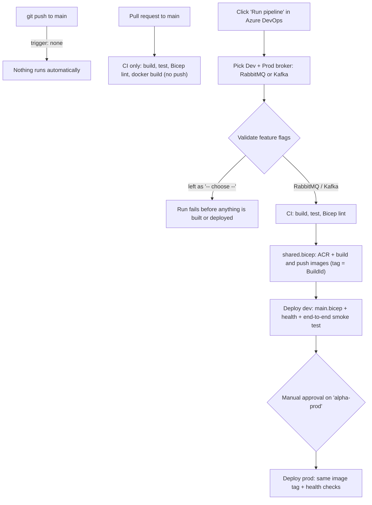
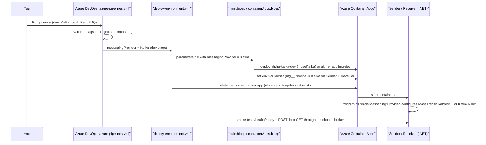
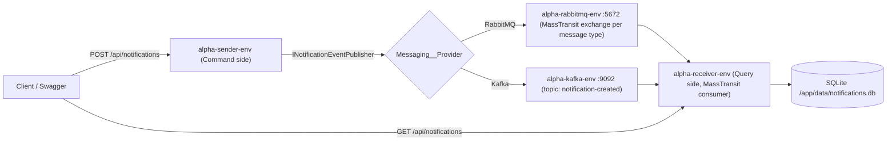

# ☁️ Deploying Alpha to Azure with Azure DevOps (dev + prod)

The complete guide to how the **Alpha CQRS Platform** gets built, provisioned, and run in Azure. It covers **Azure Repos**, **Azure Pipelines**, **Bicep**, and **Azure Container Apps**, plus the **RabbitMQ / Kafka feature flag** that you pick **on every deployment**.

**Contents**

1. [How It Works (Overview)](#1-how-it-works-overview)
2. [Choosing RabbitMQ or Kafka on Every Run](#2-choosing-rabbitmq-or-kafka-on-every-run)
3. [Target Architecture & Azure Resources](#3-target-architecture--azure-resources)
4. [Pipeline: Triggers & Stages in Detail](#4-pipeline-triggers--stages-in-detail)
5. [Infrastructure as Code (Bicep) in Detail](#5-infrastructure-as-code-bicep-in-detail)
6. [How the Microservices Run in Azure](#6-how-the-microservices-run-in-azure)
7. [One-Time Setup](#7-one-time-setup)
8. [Day-to-Day Operations](#8-day-to-day-operations)
9. [Cost](#9-cost)
10. [Security Model](#10-security-model)
11. [Troubleshooting](#11-troubleshooting)

---

## 1. How It Works (Overview)



In short:

- **You decide when to deploy.** Pushing to `main` does **not** start a deployment. You click **Run pipeline** in Azure DevOps.
- **You decide which broker to use, every time.** The run form has two required dropdowns: **Dev Messaging Provider** and **Prod Messaging Provider**. If you leave either one on `-- choose --`, the run stops in the first job.
- **The image is built once and promoted.** The Docker images for a run are tagged with `$(Build.BuildId)`. `dev` and `prod` both deploy that same tag from one shared registry.
- **Bicep owns the infrastructure.** Every deployment runs `main.bicep`, which is idempotent. It creates anything missing, updates anything that changed, and deploys only the broker you picked.
- **Prod is gated.** The prod stage waits for a human to approve it on the `alpha-prod` environment.

Key files:

| File | Role |
|---|---|
| [`azure-pipelines.yml`](../azure-pipelines.yml) | Multi-stage pipeline: triggers, required broker parameters, `CI` → `Deploy_Dev` → `Deploy_Prod` |
| [`pipelines/templates/deploy-environment.yml`](../pipelines/templates/deploy-environment.yml) | Reusable per-environment job: Bicep what-if + deploy, removing the unused broker, smoke tests |
| [`infra/bicep/shared.bicep`](../infra/bicep/shared.bicep) + [`modules/containerRegistry.bicep`](../infra/bicep/modules/containerRegistry.bicep) | Shared Azure Container Registry in `alpha-rg-shared` |
| [`infra/bicep/main.bicep`](../infra/bicep/main.bicep) | Per-environment entrypoint (`environmentName`, **required** `messagingProvider`) |
| [`infra/bicep/modules/network.bicep`](../infra/bicep/modules/network.bicep) | VNet + `/23` subnet delegated to Container Apps |
| [`infra/bicep/modules/containerApps.bicep`](../infra/bicep/modules/containerApps.bicep) | Log Analytics, Container Apps Environment, broker (RabbitMQ **or** Kafka), Sender, Receiver |
| [`scripts/setup-azure-devops.ps1`](../scripts/setup-azure-devops.ps1) | One-time Azure + Azure DevOps bootstrap |

---

## 2. Choosing RabbitMQ or Kafka on Every Run

### 2.1 What you see

**Pipelines → Alpha-CI-CD → Run pipeline** opens a form like this:

| Field | Options | Default |
|---|---|---|
| Branch/tag | `main` | `main` |
| **Dev Messaging Provider (Feature Flag) — REQUIRED** | `-- choose --` · `RabbitMQ` · `Kafka` | `-- choose --` |
| **Prod Messaging Provider (Feature Flag) — REQUIRED** | `-- choose --` · `RabbitMQ` · `Kafka` | `-- choose --` |

Pick a broker for each environment, then click **Run**. The stage names show what you picked, e.g. **Deploy → dev (Kafka)** and **Deploy → prod (RabbitMQ)**.

> [!IMPORTANT]
> Azure DevOps requires every runtime parameter to have a default. So the default is the placeholder `-- choose --`, and the **Validate feature flags** job rejects it. That means a deployment can't start until you've made a real choice for **both** environments. Your prod choice is used only after the prod approval.

### 2.2 When the prompt appears

| How the run starts | Prompt shown? | Result |
|---|---|---|
| **Run pipeline** in the Azure DevOps UI | ✅ **Yes, every time** | Deploys with the brokers you picked |
| `git push` / merge to `main` | — | **Nothing runs** (`trigger: none`) |
| Pull request into `main` (branch policy build validation) | ❌ No | **CI only.** Build, test, Bicep lint, and `docker build`. Nothing is pushed or deployed, so no broker choice is needed. |
| `az pipelines run --name Alpha-CI-CD` (CLI) | ❌ No form | Pass `--parameters devMessagingProvider=Kafka prodMessagingProvider=RabbitMQ`. Without them, the run fails validation. |
| `az deployment group create ... main.bicep` (manual Bicep, interactive terminal) | ✅ Azure CLI prompts for `messagingProvider` if you leave it out | `main.bicep` has **no default** for `messagingProvider` |

> [!NOTE]
> **Why Bicep itself doesn't prompt inside the pipeline:** pipeline agents are headless, so there's no terminal for anyone to type into. If Bicep waited for input there, the job would hang until it timed out. Azure DevOps **runtime parameters** take the input before the run starts. The template then passes it to Bicep explicitly through a parameters file.

### 2.3 How the choice flows through the system



### 2.4 Switching an existing environment

Run the pipeline again and pick the other broker. During the deploy step:

1. Bicep deploys the newly selected broker app (`alpha-kafka-{env}` or `alpha-rabbitmq-{env}`).
2. Sender and Receiver get a new revision with the updated `Messaging__Provider`.
3. The template **deletes the previous broker app** so you never pay for both.
4. The smoke tests confirm messages flow through the new broker.

> [!WARNING]
> The brokers aren't persistent. Each one runs as a single replica with no attached volume. Switching brokers, or restarting a broker, **drops any undelivered in-flight messages**. Notifications already stored in the Receiver's database are unaffected, but they disappear too if the Receiver restarts (see §6.3).

---

## 3. Target Architecture & Azure Resources

```
                         ┌──────────────── alpha-rg-shared ────────────────┐
  Azure Pipelines ──push─▶  Azure Container Registry (alphaacr<unique>)    │
                         └──────────────────────┬──────────────────────────┘
                                                │ same image tag promoted
                    ┌───────────────────────────┴───────────────────────────┐
                    ▼                                                       ▼
 ┌──────────── alpha-rg-dev ─────────────┐          ┌──────────── alpha-rg-prod ────────────┐
 │ VNet 10.20.0.0/16 (ACA subnet /23)    │          │ VNet 10.30.0.0/16 (ACA subnet /23)    │
 │ Log Analytics (30d, 0.1 GB/day cap)   │          │ Log Analytics (30d, 0.1 GB/day cap)   │
 │ Container Apps Environment            │          │ Container Apps Environment            │
 │  ├─ alpha-sender-dev   (1–2, public)  │          │  ├─ alpha-sender-prod  (1–5, public)  │
 │  ├─ alpha-receiver-dev (1,   public)  │          │  ├─ alpha-receiver-prod(1,   public)  │
 │  └─ ONE broker (internal TCP only):   │          │  └─ ONE broker (internal TCP only):   │
 │      alpha-rabbitmq-dev :5672   OR    │          │      alpha-rabbitmq-prod :5672  OR    │
 │      alpha-kafka-dev    :9092         │          │      alpha-kafka-prod    :9092        │
 └───────────────────────────────────────┘          └───────────────────────────────────────┘
```

### 3.1 Resource inventory

The pipeline creates everything. You don't need to create any Azure resources by hand.

| Resource group | Resource | Name | Sizing | Purpose |
|---|---|---|---|---|
| `alpha-rg-shared` | Azure Container Registry | `alphaacr<unique>` | `Basic`, pruned to the newest 10 tags per repo | Stores `alpha/notification-sender` and `alpha/notification-receiver` images |
| `alpha-rg-{env}` | Virtual Network + subnet | `alpha-vnet-{env}` / `snet-container-apps` | `/16` VNet, `/23` subnet delegated to `Microsoft.App/environments` | Container Apps needs a custom VNet for **TCP ingress**, which both brokers use |
| `alpha-rg-{env}` | Log Analytics workspace | `alpha-logs-{env}` | `PerGB2018`, 30-day retention, 0.1 GB/day cap | Container console and system logs |
| `alpha-rg-{env}` | Container Apps Environment | `alpha-env-{env}` | `Consumption` workload profile, VNet-integrated, public | Hosts the 3 apps |
| `alpha-rg-{env}` | Container App: Sender | `alpha-sender-{env}` | 0.25 vCPU / 0.5 GiB; dev 1–2, prod 1–5 replicas; scales on HTTP (50 concurrent requests) | Command API: `POST /api/notifications` |
| `alpha-rg-{env}` | Container App: Receiver | `alpha-receiver-{env}` | 0.25 vCPU / 0.5 GiB; **exactly 1 replica** | Query API `GET /api/notifications` + MassTransit consumer + SQLite |
| `alpha-rg-{env}` | Container App: RabbitMQ **(only if `RabbitMQ`)** | `alpha-rabbitmq-{env}` | 0.5 vCPU / 1 GiB, 1 replica, `rabbitmq:3.13-alpine`, internal TCP `5672` | AMQP broker |
| `alpha-rg-{env}` | Container App: Kafka **(only if `Kafka`)** | `alpha-kafka-{env}` | 0.5 vCPU / 1 GiB, 1 replica, `apache/kafka:3.8.1` (KRaft, no ZooKeeper), internal TCP `9092`, 256 MB heap | Kafka broker + controller |

### 3.2 Dev vs. prod

| Setting | `dev` | `prod` |
|---|---|---|
| Resource group | `alpha-rg-dev` | `alpha-rg-prod` |
| Azure DevOps environment | `alpha-dev` (no checks) | `alpha-prod` (**approval required**) |
| Variable group | `alpha-dev` | `alpha-prod` |
| Broker | Chosen per run (**Dev Messaging Provider**) | Chosen per run (**Prod Messaging Provider**) |
| VNet range | `10.20.0.0/16` | `10.30.0.0/16` |
| Sender replicas | 1–2 | 1–5 |
| Swagger UI (`/swagger`) | ✅ enabled | ❌ disabled |
| Post-deploy checks | `/health/ready` + end-to-end message test | `/health/ready` only (no test data written to prod) |

Per-environment values are in the `envConfig` map in [`main.bicep`](../infra/bicep/main.bicep).

---

## 4. Pipeline: Triggers & Stages in Detail

### 4.1 Triggers

| Setting in `azure-pipelines.yml` | Effect |
|---|---|
| `trigger: none` | Pushes to any branch never start a run. Deployments are always manual. |
| `pr: branches: [main]` | GitHub-hosted repos run CI on pull requests. **Azure Repos ignores this setting.** There, CI on pull requests comes from the **branch policy → Build validation** on `main` (see Step 7). |
| `parameters:` | Two required broker dropdowns, each defaulting to the `-- choose --` placeholder |

### 4.2 Stage 1 — `CI` (Build & Test)

| Job | Runs when | What it does |
|---|---|---|
| `ValidateFlags` | Not a PR | Fails unless both parameters are `RabbitMQ` or `Kafka` |
| `Build` | Always | `dotnet restore/build/test` on `testDotNet.sln` (.NET 9), publishes test results, then `az bicep build` on `shared.bicep` and `main.bicep` |
| `ImagesPR` | PRs only | `docker build` both images to prove the Dockerfiles work. Nothing is pushed. |
| `Images` | Not a PR, branch `main`, and **`ValidateFlags` + `Build` succeeded** | 1) Best-effort `az provider register`; 2) creates `alpha-rg-shared` and deploys `shared.bicep` (ACR); 3) `docker build` + `push` with tag `$(Build.BuildId)`; 4) prunes each repo to its newest 10 tags; 5) passes `acrName` to the deploy stages as an output variable |

### 4.3 Stage 2 — `Deploy_Dev` → `deploy-environment.yml`

Runs automatically once CI succeeds. It's a **deployment job** targeting the Azure DevOps environment `alpha-dev`, so you get deployment history per environment.

1. **Secret check.** If the broker is `RabbitMQ`, `RABBITMQ_PASSWORD` must exist in the `alpha-dev` variable group. If it's `Kafka`, a placeholder is used, because `main.bicep` declares the parameter even when RabbitMQ isn't deployed.
2. **`az group create alpha-rg-dev`**, which is idempotent.
3. **Parameters file.** `jq` writes a temporary ARM parameters JSON file containing `environmentName`, `location`, `projectName`, `imageTag`, `acrName`, `acrResourceGroup`, `messagingProvider`, and `rabbitmqPassword`. Special characters in secrets can't break CLI parsing, and the file is deleted when the job exits.
4. **`az deployment group what-if`.** Prints a preview of changes to the log.
5. **`az deployment group create`** with `main.bicep` (deployment name `alpha-dev-<BuildId>`).
6. **Removes the unused broker.** Deletes `alpha-kafka-dev` when you chose RabbitMQ, or `alpha-rabbitmq-dev` when you chose Kafka, if it still exists.
7. **Smoke test: health.** Polls `https://<sender>/health/ready` and `https://<receiver>/health/ready` up to 30 × 10 s, expecting `200`.
8. **Smoke test: end-to-end** (dev only). `POST`s a notification to the Sender, then polls `GET /api/notifications/{id}` on the Receiver up to 24 × 5 s. This proves the message actually travelled through the chosen broker.

### 4.4 Stage 3 — `Deploy_Prod`

Same template, with `alpha-prod`, `alpha-rg-prod`, the `alpha-prod` variable group, and your **Prod Messaging Provider** choice. The stage waits for the **approval check** on the `alpha-prod` environment. After approval, it deploys the **exact image tag** that passed in dev and runs only the health checks.

> [!TIP]
> If you reject or skip the prod approval, dev stays deployed and the run ends as *partially succeeded*. That's a handy way to try Kafka in dev without touching prod.

### 4.5 Pipeline variables

Defined at the top of [`azure-pipelines.yml`](../azure-pipelines.yml):

| Variable | Value | Notes |
|---|---|---|
| `azureServiceConnection` | `alpha-azure` | ARM service connection name |
| `location` | `uksouth` | Region for all resource groups |
| `projectName` | `alpha` | Resource-name prefix |
| `sharedResourceGroup` | `alpha-rg-shared` | Where the ACR lives |
| `imageTag` | `$(Build.BuildId)` | Unique, immutable tag per run |
| `vmImage` | `ubuntu-latest` | Microsoft-hosted agent |

---

## 5. Infrastructure as Code (Bicep) in Detail

### 5.1 `main.bicep` parameters

| Parameter | Required? | Default | Notes |
|---|---|---|---|
| `environmentName` | ✅ | — | `dev` or `prod` |
| `imageTag` | ✅ | — | Build ID from the pipeline |
| `acrName` | ✅ | — | Output of `shared.bicep` |
| `acrResourceGroup` | ✅ | — | `alpha-rg-shared` |
| **`messagingProvider`** | ✅ | **none** | `@allowed(['RabbitMQ', 'Kafka'])`. No default, so you always choose it explicitly. |
| `rabbitmqPassword` | ✅ | — | `@secure()`, `@minLength(12)` |
| `location` | ❌ | resource group location | |
| `projectName` | ❌ | `alpha` | |
| `rabbitmqUsername` | ❌ | `alpha` | |

Outputs: `senderFqdn`, `receiverFqdn`, `messagingProvider`, `brokerAppName`.

### 5.2 How the feature flag is applied in `containerApps.bicep`

```bicep
var useKafka = toLower(messagingProvider) == 'kafka'

resource rabbitApp '...containerApps@2024-03-01' = if (!useKafka) { ... }  // TCP 5672
resource kafkaApp  '...containerApps@2024-03-01' = if (useKafka)  { ... }  // TCP 9092
```

Both microservices get the **same** environment variables. The app uses only the set that matches `Messaging__Provider`:

| Env var | Value |
|---|---|
| `Messaging__Provider` | `RabbitMQ` or `Kafka` (the flag) |
| `RabbitMQ__Host` | `alpha-rabbitmq-{env}`, the short app name, which resolves inside the environment's VNet |
| `RabbitMQ__Username` / `RabbitMQ__Password` | `alpha` / Container Apps secret `rabbitmq-password` |
| `Kafka__BootstrapServers` | `alpha-kafka-{env}:9092` |
| `Kafka__Topic` | `notification-created` |
| `Swagger__Enabled` | `true` (dev) / `false` (prod) |
| `ASPNETCORE_HTTP_PORTS` | `8080` |
| `ASPNETCORE_FORWARDEDHEADERS_ENABLED` | `true` (Container Apps terminates TLS) |
| `ConnectionStrings__DefaultConnection` (Receiver only) | `Data Source=/app/data/notifications.db` |

### 5.3 Running Bicep manually (outside the pipeline)

```powershell
az deployment group create `
  --resource-group alpha-rg-dev `
  --template-file infra/bicep/main.bicep `
  --parameters environmentName=dev imageTag=<buildId> acrName=<acrName> `
               acrResourceGroup=alpha-rg-shared messagingProvider=Kafka `
               rabbitmqPassword=<secret>
```

If you leave out `messagingProvider`, the Azure CLI prompts for it in an interactive terminal and fails in a non-interactive one. When you switch brokers manually, delete the old broker app yourself (`az containerapp delete -g alpha-rg-dev -n alpha-rabbitmq-dev --yes`).

---

## 6. How the Microservices Run in Azure

### 6.1 Message flow



- **Sender.** `SendNotificationCommandHandler` publishes `NotificationCreatedEvent` through `INotificationEventPublisher`. `Program.cs` registers `RabbitMqNotificationEventPublisher` (`IPublishEndpoint`) or `KafkaNotificationEventPublisher` (`ITopicProducer<>`), depending on `Messaging:Provider`.
- **Receiver.** Uses the MassTransit RabbitMQ transport, or the Kafka Rider (consumer group, `AutoOffsetReset.Earliest`, topic auto-created), to consume the event and write it to SQLite.
- **Bus start.** Both services set `cfg.AutoStart = true`. The Sender has no consumers, and without this its bus would never connect, so `/health/ready` would fail.

### 6.2 Networking & health probes

- Sender and Receiver have **external HTTPS ingress** (port 8080 inside the container, TLS terminated by Container Apps).
- The broker has **internal TCP ingress only**, so it can't be reached from the internet.
- Health endpoints:

| Endpoint | Checks | Used by |
|---|---|---|
| `/health/live` | The web process is up | Container Apps **liveness** and **readiness** probes |
| `/health/ready` | The MassTransit bus is connected to the broker | Pipeline smoke tests |

  Readiness deliberately uses `/health/live`. If it used `/health/ready`, a broker restart would make Envoy stop routing to the API, and requests would time out (the earlier `000` smoke-test failure).

### 6.3 Data & scaling constraints

- The **Receiver is pinned to 1 replica**. It uses a container-local SQLite file, so multiple replicas would each have their own database. Data is **lost when the Receiver container restarts or is redeployed**. Use Azure SQL or PostgreSQL for durable production data.
- The **Sender** scales on HTTP concurrency (50 requests per replica).
- **Brokers** run as 1 replica each and aren't durable (see the warning in §2.4).

### 6.4 URLs

After a deploy, the URLs are printed in the **Deploy infrastructure & apps** step log:

- Sender: `https://alpha-sender-{env}.<env-domain>.uksouth.azurecontainerapps.io` (Swagger at `/swagger` in dev)
- Receiver: `https://alpha-receiver-{env}.<env-domain>.uksouth.azurecontainerapps.io`

Current dev environment:
- https://alpha-sender-dev.orangefield-f63f5cf6.uksouth.azurecontainerapps.io/swagger
- https://alpha-receiver-dev.orangefield-f63f5cf6.uksouth.azurecontainerapps.io/swagger

---

## 7. One-Time Setup

### Option A — Automated (recommended)

[`scripts/setup-azure-devops.ps1`](../scripts/setup-azure-devops.ps1) does the following:
1. Registers the `Microsoft.App`, `Microsoft.OperationalInsights`, `Microsoft.ContainerRegistry`, and `Microsoft.Network` resource providers.
2. Adds the `azure` git remote and pushes `main`.
3. Creates the `alpha-dev` and `alpha-prod` variable groups, each with a generated secret `RABBITMQ_PASSWORD`.
4. Creates the `alpha-dev` and `alpha-prod` environments.
5. Creates the `Alpha-CI-CD` pipeline from `/azure-pipelines.yml` without running it.

```powershell
az login
.\scripts\setup-azure-devops.ps1 `
  -OrganizationUrl "https://dev.azure.com/<your-org>" `
  -ProjectName "<your-project>" `
  -RepoName "<your-repo>" `
  -SubscriptionId "<your-azure-subscription-id>"
```

Then do **Step 3** (service connection), **Step 5** (prod approval), and **Step 7** (branch policy) below.

### Option B — Manual

#### Step 1 — Push the code to Azure Repos
```powershell
git remote add azure https://dev.azure.com/<org>/<project>/_git/<repo>
git push -u azure main
```

#### Step 2 — Register resource providers (once per subscription)
```powershell
az account set --subscription "<subscription-id>"
az provider register --namespace Microsoft.App
az provider register --namespace Microsoft.OperationalInsights
az provider register --namespace Microsoft.ContainerRegistry
az provider register --namespace Microsoft.Network
```

#### Step 3 — Service connection `alpha-azure`
**Project settings → Service connections → New → Azure Resource Manager**:

| Field | Value |
|---|---|
| Identity type | App registration (automatic) |
| Credential | **Workload identity federation** (no secret, never expires) |
| Scope level | **Subscription** (leave resource group blank) |
| Name | **`alpha-azure`** |
| Security | ✅ Grant access permission to all pipelines |

> [!IMPORTANT]
> The pipeline creates resource groups, so the service principal needs **Contributor** at **subscription** scope. Scoping it to a single resource group causes `AuthorizationFailed`. To fix that, run:
> ```powershell
> az role assignment create --assignee-object-id <sp-object-id> --assignee-principal-type ServicePrincipal `
>   --role Contributor --scope /subscriptions/<subscription-id>
> ```

#### Step 4 — Variable groups
**Pipelines → Library → + Variable group** (enable *Allow access to all pipelines*):

| Group | Variable | Secret? | Required when |
|---|---|---|---|
| `alpha-dev` | `RABBITMQ_PASSWORD` (≥ 12 chars) | 🔒 Yes | Dev broker = RabbitMQ |
| `alpha-prod` | `RABBITMQ_PASSWORD` (≥ 12 chars, different from dev) | 🔒 Yes | Prod broker = RabbitMQ |

```powershell
-join ((48..57)+(65..90)+(97..122) | Get-Random -Count 24 | % {[char]$_})
```

#### Step 5 — Environments & prod approval
**Pipelines → Environments → New environment** (Resource: None):
1. `alpha-dev`: no checks.
2. `alpha-prod`: **⋮ → Approvals and checks → + → Approvals**. Add yourself or your approvers group. You can also add an **Exclusive lock** check.

#### Step 6 — Create the pipeline
**Pipelines → New pipeline → Azure Repos Git → your repo → Existing Azure Pipelines YAML file → `/azure-pipelines.yml` → Save** (use the dropdown next to *Run*).

#### Step 7 — Branch policy on `main` (CI for pull requests)
**Repos → Branches → `main` → ⋮ → Branch policies → Build validation → +**, then select `Alpha-CI-CD` and set it to **Required**. Pull requests then run CI only, with no broker choice needed and no deployment.

---

## 8. Day-to-Day Operations

| I want to… | Do this |
|---|---|
| **Deploy** | Pipelines → Alpha-CI-CD → **Run pipeline** → pick Dev + Prod broker → **Run** → approve prod when prompted |
| **Deploy dev only** | Run as above, then **Reject** the prod approval (or let it time out) |
| **Switch dev from RabbitMQ to Kafka** | Run pipeline with Dev = `Kafka`. The old broker is deleted automatically. |
| **Check which broker is live** | Look at the stage name in the run (`Deploy → dev (Kafka)`), the `messagingProvider` tag on the resource group's resources, or run `az containerapp list -g alpha-rg-dev -o table` |
| **Roll back** | Re-run an older successful run (**Rerun all jobs** on that run). That redeploys its image tag with its broker choice, as long as the tag is still among the 10 kept in ACR. |
| **View logs** | Portal → Container App → **Log stream**, or `az containerapp logs show -g alpha-rg-dev -n alpha-receiver-dev --follow` |
| **Trigger from the CLI** | `az pipelines run --name Alpha-CI-CD --branch main --parameters devMessagingProvider=Kafka prodMessagingProvider=RabbitMQ` |
| **Pause all cost for an environment** | `az group delete --name alpha-rg-dev --yes --no-wait`. The next run recreates everything. |

---

## 9. Cost

| What the code does | Saving |
|---|---|
| One shared `Basic` ACR + tag pruning | One registry instead of two (~£4/month total) |
| Only the **selected** broker is deployed; the other is deleted | Never pay for both brokers |
| Smallest Container Apps sizes (0.25 vCPU / 0.5 GiB for the APIs) | Minimum billable footprint |
| Consumption plan + monthly free grant (180,000 vCPU-s, 360,000 GiB-s) | Low-traffic environments cost very little |
| Log Analytics: 30-day retention + 0.1 GB/day cap | Stays inside the 5 GB/month free tier |
| VNet without NAT Gateway or Private Endpoints | £0 |

### Estimated monthly cost (UK South)

| Resource | Estimate |
|---|---|
| Shared ACR (`Basic`) | ~£4 |
| VNets, Log Analytics (within free tier) | £0 |
| Container Apps per environment (Sender 1 + Receiver 1 at 0.25 vCPU, broker at 0.5 vCPU, all always on, minus the free grant) | ~£15–£30 |

> [!TIP]
> To save more in dev, set `senderMinReplicas: 0` in `envConfig.dev` in [`main.bicep`](../infra/bicep/main.bicep). The Sender then scales to zero when idle, at the cost of a cold start on the first request. Deleting `alpha-rg-dev` between test sessions reduces dev compute to £0.

---

## 10. Security Model

- **No stored Azure credentials.** The `alpha-azure` service connection uses workload identity federation (OIDC).
- **Secrets** (`RABBITMQ_PASSWORD`) live only in secret variables in the variable groups. They reach the agent through the step's explicit `env:` mapping, are written to a temporary parameters file that's deleted when the job exits, and go into Bicep as `@secure()`. They're stored as Container Apps **secrets** (`secretRef`), not as plain environment variables.
- **ACR credentials** are read by Bicep at deploy time (`listCredentials()`) and stored as the Container Apps secret `acr-password`.
- **Brokers are internal only.** They use TCP ingress on the environment's VNet, with no public endpoint.
- **Prod changes need a human approval** on `alpha-prod`.
- **Swagger is disabled in prod.**

> [!NOTE]
> Kafka runs as `PLAINTEXT` with no authentication inside the private VNet. Before handling sensitive data, add SASL/TLS or switch to a managed service such as Azure Event Hubs (Kafka endpoint) or Confluent Cloud.

---

## 11. Troubleshooting

| Symptom | Cause & fix |
|---|---|
| `Dev Messaging Provider was not chosen` (ValidateFlags job) | You left a dropdown on `-- choose --`. Re-run and pick `RabbitMQ` or `Kafka` for both environments. |
| Pushed to `main` and nothing happened | Expected: `trigger: none`. Click **Run pipeline**. |
| `AuthorizationFailed ... Microsoft.App/register/action` or `.../resourceGroups/write` | The service principal isn't Contributor at subscription scope. See Step 3. |
| `The subscription is not registered to use namespace 'Microsoft.App'` | Run the Step 2 commands (needs subscription Owner/Contributor). |
| `RABBITMQ_PASSWORD is missing` | Add the secret to the `alpha-dev` / `alpha-prod` variable group. Only needed when that environment uses RabbitMQ. |
| `Could not find service connection 'alpha-azure'` | Create it (Step 3) with exactly that name. |
| Run pauses: "needs permission to access a resource" | Click **View → Permit** for the service connection, variable group, or environment. |
| Smoke test `/health/ready` → `503` | The app is up but the bus isn't connected. Check the broker app's logs; Kafka can take 30–60 s on first start. |
| Smoke test → `000` (timeout) | The app isn't receiving traffic. Check the revision status and console logs: `az containerapp revision list -g alpha-rg-dev -n alpha-sender-dev -o table`. |
| End-to-end test: `not yet consumed (404)` | The Receiver isn't consuming. Check `Messaging__Provider` matches on both apps and that the broker app exists, then check the Receiver logs. |
| First deploy takes 10–20 minutes | Normal: VNet + Container Apps Environment creation is slow. Later runs take about 3–6 minutes. |
