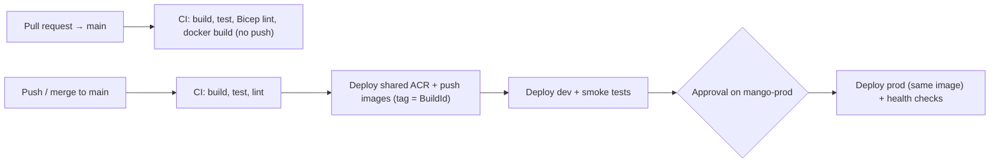

# ☁️ Deploying Mango to Azure with Azure DevOps (dev + prod)

This is the end-to-end plan for getting the platform running in Azure with two
environments — **dev** and **prod** — using Azure Repos, Azure Pipelines and Bicep.

---

## 1. Target architecture

```
                         ┌──────────────── mango-rg-shared ────────────────┐
  Azure Pipelines ──push─▶  Azure Container Registry (mangoacr<unique>)     │
                         └──────────────────────┬──────────────────────────┘
                                                │ same image tag promoted
                    ┌───────────────────────────┴───────────────────────────┐
                    ▼                                                       ▼
 ┌──────────── mango-rg-dev ────────────┐          ┌──────────── mango-rg-prod ───────────┐
 │ VNet (10.20.0.0/16)                   │          │ VNet (10.30.0.0/16)                   │
 │ Log Analytics                         │          │ Log Analytics (90-day retention)      │
 │ Container Apps Environment            │          │ Container Apps Environment            │
 │  ├─ mango-sender-dev    (public HTTPS)│          │  ├─ mango-sender-prod   (public HTTPS)│
 │  ├─ mango-receiver-dev  (public HTTPS)│          │  ├─ mango-receiver-prod (public HTTPS)│
 │  └─ mango-rabbitmq-dev  (internal TCP)│          │  └─ mango-rabbitmq-prod (internal TCP)│
 └───────────────────────────────────────┘          └───────────────────────────────────────┘
```

| Item | dev | prod |
|---|---|---|
| Resource group | `mango-rg-dev` | `mango-rg-prod` |
| Azure DevOps environment | `mango-dev` (no checks) | `mango-prod` (**approval required**) |
| Variable group | `mango-dev` | `mango-prod` |
| Sender replicas | 1–2 | 1–5 |
| Swagger UI | ✅ enabled | ❌ disabled |
| Log retention | 30 days | 90 days |
| Smoke test | health + end-to-end message | health only |

## 2. Pipeline flow



Files:

- [`azure-pipelines.yml`](../azure-pipelines.yml) — the pipeline
- [`pipelines/templates/deploy-environment.yml`](../pipelines/templates/deploy-environment.yml) — per-environment deploy job
- [`infra/bicep/shared.bicep`](../infra/bicep/shared.bicep) — shared container registry
- [`infra/bicep/main.bicep`](../infra/bicep/main.bicep) — per-environment infrastructure

---

## 3. One-time setup (do these in order)

### Step 1 — Push the code to Azure Repos

```powershell
git remote add azure https://dev.azure.com/<org>/<project>/_git/<repo>
git push -u azure main
```

### Step 2 — Make sure you have Azure permissions

You need an Azure subscription, and you need to be **Owner** (or *Contributor + User Access
Administrator*) on it so Azure DevOps can create the service principal and role assignment.

Register the resource providers (one time per subscription):

```powershell
az login
az account set --subscription "<subscription-id>"
az provider register --namespace Microsoft.App
az provider register --namespace Microsoft.OperationalInsights
az provider register --namespace Microsoft.ContainerRegistry
az provider register --namespace Microsoft.Network
```

### Step 3 — Create the Azure service connection

**Project settings → Service connections → New service connection → Azure Resource Manager**

| Field | Value |
|---|---|
| Identity type | **App registration (automatic)** |
| Credential | **Workload identity federation** (no secrets to rotate) |
| Scope level | **Subscription** |
| Resource group | *leave empty* (the pipeline creates `mango-rg-shared`, `mango-rg-dev`, `mango-rg-prod`) |
| Service connection name | **`mango-azure`** |
| Security | ✅ Grant access permission to all pipelines *(or authorise it on the first run)* |

> [!NOTE]
> The connection gets **Contributor** on the subscription. That's enough for everything here.
> If you'd rather scope it to resource groups, create the three resource groups yourself first
> and give the service principal Contributor on each of them.

### Step 4 — Create the variable groups (secrets)

**Pipelines → Library → + Variable group**. Create two groups:

| Variable group | Variable | Value | Secret? |
|---|---|---|---|
| `mango-dev` | `RABBITMQ_PASSWORD` | a strong password, ≥ 12 chars | 🔒 **Yes** |
| `mango-prod` | `RABBITMQ_PASSWORD` | a *different* strong password, ≥ 12 chars | 🔒 **Yes** |

Generate one with: `-join ((48..57)+(65..90)+(97..122) | Get-Random -Count 24 | % {[char]$_})`

> [!IMPORTANT]
> The RabbitMQ user/password is created when the broker **first starts**. Because broker storage
> is ephemeral, changing the password later works after the next RabbitMQ restart/redeploy.

### Step 5 — Create the environments and the prod approval

**Pipelines → Environments → New environment** (resource: *None*):

1. `mango-dev` — no checks.
2. `mango-prod` — then **⋮ → Approvals and checks → + → Approvals**, add yourself (or a group).
   Optional extras on `mango-prod`:
   - **Exclusive lock** — stops two prod deployments running at once.
   - **Business hours** — only deploy during working hours.

### Step 6 — Create the pipeline

**Pipelines → New pipeline → Azure Repos Git → select the repo → Existing Azure Pipelines YAML file → `/azure-pipelines.yml` → Run**.

On the first run Azure DevOps may ask you to **Permit** access to the service connection,
variable groups and environments — approve each one.

### Step 7 — Protect `main` (recommended)

**Repos → Branches → main → ⋮ → Branch policies**:

- ✅ Require a minimum number of reviewers
- ✅ **Build validation** → add this pipeline → *Required*. (PR runs only build/test/lint; they never deploy.)

---

## 4. What happens on the first run

1. **CI** builds and tests the solution and lints the Bicep.
2. **Images** creates `mango-rg-shared` + the ACR (`mangoacr<unique-suffix>`), builds both images and pushes them as `:<BuildId>`.
3. **Deploy → dev** creates `mango-rg-dev`, shows a what-if, deploys the VNet, logs, Container Apps environment and the three apps, then:
   - waits for `/health/ready` on Sender and Receiver
   - POSTs a notification to the Sender and polls the Receiver until it has arrived through RabbitMQ
4. **Deploy → prod** waits for your approval, then deploys the **same image tag** to `mango-rg-prod` and checks health.

> [!NOTE]
> The very first deployment of each environment takes **~10–15 minutes** (the VNet-integrated
> Container Apps environment takes a while to create). Later deployments take 2–4 minutes.

The app URLs are printed in the *Deploy infrastructure & apps* step log, e.g.

```
Sender:   https://mango-sender-dev.<hash>.uksouth.azurecontainerapps.io
Receiver: https://mango-receiver-dev.<hash>.uksouth.azurecontainerapps.io
```

Swagger (dev only): `https://<sender-fqdn>/swagger`, `https://<receiver-fqdn>/swagger`.

---

## 5. Day-to-day workflow

```
feature branch → PR to main (CI validates) → merge → auto deploy dev → approve → prod
```

**Rollback:** re-run the *Deploy → prod* stage of an older successful run (**Pipelines → run → Rerun stage**). It redeploys that run's image tag.

**Logs:** Azure Portal → Container App → *Log stream*, or Log Analytics:

```kusto
ContainerAppConsoleLogs_CL
| where ContainerAppName_s startswith "mango-"
| order by TimeGenerated desc
```

---

## 6. Code changes made for Azure

| Change | Why |
|---|---|
| Container Apps environment is **VNet-integrated** ([network.bicep](../infra/bicep/modules/network.bicep)) | Azure Container Apps only supports **TCP ingress** (needed for RabbitMQ/AMQP) in a custom VNet. Without it the deployment fails. |
| **Shared ACR** in `mango-rg-shared` | Build once, promote the identical image dev → prod. Name is auto-generated and globally unique. |
| RabbitMQ credentials from a **secret variable group** → Container Apps `secretRef` | Removed hard-coded `guest/guest`. |
| `/health/live` and `/health/ready` endpoints | Liveness doesn't depend on RabbitMQ (no restart loops); readiness includes the MassTransit bus check. |
| `Swagger__Enabled` setting | Swagger on in dev, off in prod. |
| `ASPNETCORE_FORWARDEDHEADERS_ENABLED=true` | Container Apps terminates TLS; the app needs `X-Forwarded-Proto` to see HTTPS. |
| Receiver pinned to **1 replica** | It uses a local SQLite file; more replicas would mean separate databases and split messages. |
| `.dockerignore` added | Stops host `bin/obj`, `.git` and local DB files entering the image build. |
| Local `*.db` files untracked / ignored | Runtime data shouldn't be in git. |
| Terraform, old Bicep pipeline and GitHub Actions removed | One IaC tool (Bicep) and one CI/CD system (Azure DevOps). |

---

## 7. Known limitations and next steps

> [!WARNING]
> **Data is not durable yet.** The Receiver's SQLite file and RabbitMQ's queues live on the
> container's ephemeral disk, so a restart/redeploy clears notification history and any
> unconsumed messages. That's fine for dev but should be fixed before real prod traffic.

Recommended order:

1. **Receiver → Azure SQL / PostgreSQL Flexible Server** (EF Core provider swap). Then the Receiver can scale out.
2. **RabbitMQ → Azure Service Bus** (MassTransit supports it natively), or mount Azure Files for RabbitMQ.
3. **Managed identity for ACR pulls** (`AcrPull` role) instead of the ACR admin user.
4. **Key Vault** for secrets, linked to the variable groups.
5. **Authentication** on the public APIs (Entra ID / API Management).
6. **Tests**: add `*.Tests` projects — the pipeline's `dotnet test` step already picks them up.

## 8. Cost (approximate, UK South)

| Resource | Per environment |
|---|---|
| Container Apps (≈3 always-on small replicas) | ~£25–40 / month |
| Log Analytics | usage-based, typically a few £ in dev |
| VNet | free |
| ACR Basic (shared) | ~£4 / month total |

Tip: to save money on dev, scale it down out of hours, or delete `mango-rg-dev` — the pipeline recreates it.

## 9. Troubleshooting

| Symptom | Fix |
|---|---|
| `RABBITMQ_PASSWORD is missing` | Add it as a **secret** to the `mango-dev` / `mango-prod` variable group and authorise the group for the pipeline. |
| `The subscription is not registered to use namespace 'Microsoft.App'` | Run the `az provider register` commands in Step 2. |
| `Could not find service connection 'mango-azure'` | Name the connection exactly `mango-azure`, or change `azureServiceConnection` in `azure-pipelines.yml`. |
| Pipeline waits with *"needs permission"* | Open the run and click **Permit** for the resource. |
| Smoke test: health never 200 | Portal → Container App → *Revisions* / *Log stream*. Usually RabbitMQ still starting or a wrong password. |
| Subnet / address-space conflicts | Change `vnetAddressPrefix` / `acaSubnetPrefix` in `main.bicep` (`envConfig`). |
