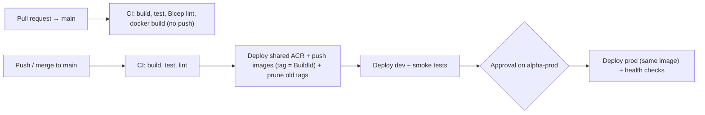

# ☁️ Deploying Alpha to Azure with Azure DevOps (dev + prod)

This is the complete, production-ready guide for deploying the **Alpha CQRS Platform** to Azure across **dev** and **prod** environments using **Azure Repos**, **Azure Pipelines**, and **Bicep** — tuned for **maximum automation** and **minimal Azure cost**.

---

## 1. Target Architecture & Azure Resource Inventory

```
                         ┌──────────────── alpha-rg-shared ────────────────┐
  Azure Pipelines ──push─▶  Azure Container Registry (alphaacr<unique>)     │
                         └──────────────────────┬──────────────────────────┘
                                                │ same image tag promoted
                    ┌───────────────────────────┴───────────────────────────┐
                    ▼                                                       ▼
 ┌──────────── alpha-rg-dev ────────────┐          ┌──────────── alpha-rg-prod ───────────┐
 │ VNet (10.20.0.0/16)                   │          │ VNet (10.30.0.0/16)                   │
 │ Log Analytics (30d, 0.1 GB/day cap)   │          │ Log Analytics (30d, 0.1 GB/day cap)   │
 │ Container Apps Environment            │          │ Container Apps Environment            │
 │  ├─ alpha-sender-dev    (0–2 replicas)│          │  ├─ alpha-sender-prod   (0–5 replicas)│
 │  ├─ alpha-receiver-dev  (1 replica)   │          │  ├─ alpha-receiver-prod (1 replica)   │
 │  └─ alpha-rabbitmq-dev  (1 replica)   │          │  └─ alpha-rabbitmq-prod (1 replica)   │
 └───────────────────────────────────────┘          └───────────────────────────────────────┘
```

### Complete List of Azure Resources Provisioned

All resource groups and resources are created **automatically by the pipeline** — you do not need to create any Azure resources manually.

| Resource Group | Azure Resource Type | Name | SKU / Sizing | Why It Is Needed |
|---|---|---|---|---|
| `alpha-rg-shared` | **Azure Container Registry (ACR)** | `alphaacr<unique>` | `Basic` (10 GB included, auto-pruned to last 10 tags) | Stores `notification-sender` & `notification-receiver` Docker images once and promotes the exact same image from `dev` → `prod`. |
| `alpha-rg-dev` & `alpha-rg-prod` | **Virtual Network + Subnet** | `alpha-vnet-{env}` / `snet-container-apps` | Standard VNet (`/16` + `/23` delegated subnet) | Required by Azure Container Apps to allow internal **TCP ingress** (port `5672` AMQP) for RabbitMQ. |
| `alpha-rg-dev` & `alpha-rg-prod` | **Log Analytics Workspace** | `alpha-logs-{env}` | `PerGB2018`, 30-day retention, **0.1 GB/day cap** | Stores container console and system logs while staying 100% inside Azure's **5 GB/month free tier**. |
| `alpha-rg-dev` & `alpha-rg-prod` | **Container Apps Environment** | `alpha-env-{env}` | `Consumption` workload profile | Serverless hosting environment shared by the 3 container apps in each environment ($0 base fee). |
| `alpha-rg-dev` & `alpha-rg-prod` | **Container App — Sender** | `alpha-sender-{env}` | `0.25 vCPU`, `0.5 GiB` RAM, **0 → 2/5 replicas** | Stateless CQRS Command API (`POST /api/notifications`). Scales to **0 replicas ($0)** when idle and wakes on HTTP request. |
| `alpha-rg-dev` & `alpha-rg-prod` | **Container App — Receiver** | `alpha-receiver-{env}` | `0.25 vCPU`, `0.5 GiB` RAM, **1 replica** | CQRS Query API (`GET /api/notifications`) + MassTransit consumer (RabbitMQ or Kafka) + local SQLite store. |
| `alpha-rg-dev` & `alpha-rg-prod` | **Container App — Broker (`RabbitMQ` OR `Kafka`)** | `alpha-rabbitmq-{env}` *or* `alpha-kafka-{env}` | `0.5 vCPU`, `1 GiB` RAM, **1 replica** | Controlled by the `messagingProvider` feature flag (`RabbitMQ` or `Kafka`). Only the selected broker is deployed; the unselected one is not created (or is removed if switching). |

### Switching Between RabbitMQ and Kafka (Feature Flag)

Both `NotificationSender` and `NotificationReceiver` support switching between **RabbitMQ** and **Apache Kafka (KRaft mode)** via a single feature flag:

1. **In Azure DevOps UI (Per-Run Dropdown)**:
   - Click **Run pipeline** in Azure DevOps → choose **`RabbitMQ`** or **`Kafka`** from the **Dev Messaging Provider** and **Prod Messaging Provider** dropdowns!
2. **In Pipeline YAML (Default for Automated Git Pushes)**:
   - Edit `parameters` (`devMessagingProvider` / `prodMessagingProvider` default values) at the top of [`azure-pipelines.yml`](../azure-pipelines.yml).
3. **In Bicep Directly**:
   - Pass `--parameters messagingProvider=Kafka` (or `RabbitMQ`) to [`infra/bicep/main.bicep`](../infra/bicep/main.bicep).
   - Bicep injects `Messaging__Provider` into both microservices and provisions **only** the chosen broker (`alpha-rabbitmq-{env}` on TCP port `5672` or `alpha-kafka-{env}` on TCP port `9092`), while the deployment script automatically deletes the unused broker container app so you never pay for both.

### Dev vs. Prod Environment Differences

| Setting | `dev` | `prod` |
|---|---|---|
| Resource group | `alpha-rg-dev` | `alpha-rg-prod` |
| Azure DevOps Environment | `alpha-dev` (auto-deploy) | `alpha-prod` (**manual approval gate**) |
| Variable group (secrets) | `alpha-dev` | `alpha-prod` |
| Sender scaling | **0**–2 replicas (scale-to-zero) | **0**–5 replicas (scale-to-zero) |
| Receiver & RabbitMQ scaling | 1 replica each (`0.25 vCPU / 0.5 GiB`) | 1 replica each (`0.25 vCPU / 0.5 GiB`) |
| Swagger UI (`/swagger`) | ✅ Enabled | ❌ Disabled |
| Log retention & daily cap | 30 days, 0.1 GB/day cap | 30 days, 0.1 GB/day cap |
| Post-deploy verification | `/health/ready` + end-to-end RabbitMQ message test | `/health/ready` check only (no test data written to prod) |

---

## 2. Pipeline Flow



Key files in this repo:

- [`azure-pipelines.yml`](../azure-pipelines.yml) — multi-stage CI/CD pipeline (`CI` → `Deploy_Dev` → `Deploy_Prod`)
- [`pipelines/templates/deploy-environment.yml`](../pipelines/templates/deploy-environment.yml) — reusable deployment + smoke-test job template
- [`infra/bicep/shared.bicep`](../infra/bicep/shared.bicep) — shared Azure Container Registry
- [`infra/bicep/main.bicep`](../infra/bicep/main.bicep) — per-environment Bicep entrypoint (`dev` / `prod`)
- [`infra/bicep/modules/network.bicep`](../infra/bicep/modules/network.bicep) — VNet + delegated Container Apps subnet
- [`infra/bicep/modules/containerApps.bicep`](../infra/bicep/modules/containerApps.bicep) — Log Analytics, Container Apps Environment, RabbitMQ, Sender, Receiver
- [`scripts/setup-azure-devops.ps1`](../scripts/setup-azure-devops.ps1) — one-shot PowerShell script to automate Azure & Azure DevOps setup

---

## 3. One-Time Setup (Automated + Step-by-Step)

### Option A — Automated Setup via PowerShell (Recommended)

Run [`scripts/setup-azure-devops.ps1`](../scripts/setup-azure-devops.ps1) to automatically:
1. Register the required Azure resource providers on your subscription
2. Add your Azure Repos `azure` remote and push `main`
3. Generate strong 24-character passwords and create the `alpha-dev` and `alpha-prod` Variable Groups with secret `RABBITMQ_PASSWORD`
4. Create the `alpha-dev` and `alpha-prod` Azure DevOps Environments
5. Create the `Alpha-CI-CD` pipeline from `/azure-pipelines.yml`

```powershell
az login

.\scripts\setup-azure-devops.ps1 `
  -OrganizationUrl "https://dev.azure.com/<your-org>" `
  -ProjectName "<your-project>" `
  -RepoName "<your-repo>" `
  -SubscriptionId "<your-azure-subscription-id>"
```

After the script finishes, complete only **Step 3** (create the `alpha-azure` service connection) and **Step 5b** (add yourself as approver on `alpha-prod`) below.

---

### Option B — Full Step-by-Step Manual Guide

If you prefer to configure everything through the Azure DevOps UI (or verify what the script created), follow these steps in order:

#### Step 1 — Push the code to Azure Repos

```powershell
git remote add azure https://dev.azure.com/<org>/<project>/_git/<repo>
git push -u azure main
```

#### Step 2 — Register Azure Resource Providers (one time per subscription)

You need **Owner** (or *Contributor + User Access Administrator*) on your Azure subscription so Azure DevOps can create the service connection role assignment.

```powershell
az login
az account set --subscription "<subscription-id>"
az provider register --namespace Microsoft.App
az provider register --namespace Microsoft.OperationalInsights
az provider register --namespace Microsoft.ContainerRegistry
az provider register --namespace Microsoft.Network
```

#### Step 3 — Create the Azure Service Connection (`alpha-azure`)

In Azure DevOps: **Project settings (bottom-left) → Service connections → New service connection → Azure Resource Manager → Next**:

| Field | Value |
|---|---|
| Identity type | **App registration (automatic)** |
| Credential | **Workload identity federation** (secretless OIDC — never expires) |
| Scope level | **Subscription** |
| Subscription | Select your Azure subscription |
| Resource group | **Leave blank** *(the pipeline creates `alpha-rg-shared`, `alpha-rg-dev`, and `alpha-rg-prod` at subscription scope)* |
| Service connection name | **`alpha-azure`** |
| Security | ✅ **Grant access permission to all pipelines** |

#### Step 4 — Create Secret Variable Groups (`alpha-dev` & `alpha-prod`)

In Azure DevOps: **Pipelines → Library → + Variable group**. Create two groups (and enable **Allow access to all pipelines** on each):

| Variable group name | Variable name | Value | Secret (🔒)? |
|---|---|---|---|
| `alpha-dev` | `RABBITMQ_PASSWORD` | Strong password, ≥ 12 chars | 🔒 **Yes** (click the lock icon) |
| `alpha-prod` | `RABBITMQ_PASSWORD` | A *different* strong password, ≥ 12 chars | 🔒 **Yes** (click the lock icon) |

Generate a random password in PowerShell:
```powershell
-join ((48..57)+(65..90)+(97..122) | Get-Random -Count 24 | % {[char]$_})
```

#### Step 5 — Create Environments & Production Approval Gate

In Azure DevOps: **Pipelines → Environments → New environment** (select **None** for resource):

1. Create **`alpha-dev`** — leave with no checks (deploys automatically on every push to `main`).
2. Create **`alpha-prod`**:
   - Open `alpha-prod` → click **⋮ (top-right) → Approvals and checks → + → Approvals**.
   - Add yourself (or your release approvers group) and click **Create**.
   - *(Optional)* Add an **Exclusive lock** check on `alpha-prod` so two production deployments never run concurrently.

#### Step 6 — Create & Run the Pipeline

1. Go to **Pipelines → New pipeline → Azure Repos Git**.
2. Select your repository → **Existing Azure Pipelines YAML file** → select `/azure-pipelines.yml` → **Continue**.
3. Click **Run**.
4. *(If you didn't pre-authorize in Steps 3–5)* Click **View** on the yellow permission banner and click **Permit** for the service connection, variable groups, and environments.

#### Step 7 — Add Branch Protection on `main` (Recommended)

Go to **Repos → Branches → `main` → ⋮ → Branch policies**:
- Turn on **Build validation** → select your pipeline → **Required**.
  - Pull requests will automatically run the `CI` stage (`dotnet build`, `dotnet test`, `az bicep build`, and `docker build`) without pushing images or deploying.

---

## 4. What Happens When the Pipeline Runs

1. **Stage 1 — `CI` (`Build & Test`)**:
   - Restores, builds, and runs unit/integration tests across `testDotNet.sln`.
   - Compiles and lints both `infra/bicep/shared.bicep` and `infra/bicep/main.bicep`.
   - On `main` branch: creates `alpha-rg-shared` + the shared ACR, builds & pushes `alpha/notification-sender:<BuildId>` and `alpha/notification-receiver:<BuildId>`, and prunes tags older than the latest 10.
2. **Stage 2 — `Deploy_Dev` (`Deploy → dev`)**:
   - Creates `alpha-rg-dev`, runs `az deployment group what-if`, and deploys `infra/bicep/main.bicep` with `environmentName=dev`.
   - Waits for `https://<sender-dev-fqdn>/health/ready` and `https://<receiver-dev-fqdn>/health/ready` to return `200 OK`.
   - Runs an automated end-to-end CQRS test: `POST`s a notification to `NotificationSender` and polls `NotificationReceiver` until the event arrives via RabbitMQ and is persisted in SQLite.
3. **Stage 3 — `Deploy_Prod` (`Deploy → prod`)**:
   - Pauses for your **manual approval** on the `alpha-prod` environment.
   - Once approved, deploys the **exact same image tag** (`<BuildId>`) to `alpha-rg-prod` and verifies `/health/ready` on both services.

---

## 5. Minimal Cost Breakdown & How Cost Is Kept Near Zero

The Bicep templates have been specifically optimized for minimal cost:

| Optimization Applied in Code | How It Saves Money |
|---|---|
| **Single Shared ACR (`Basic` SKU)** + auto tag pruning in pipeline | 1 registry instead of 2; pruning keeps storage well inside the included 10 GB (~**£4 / $5 per month total** across both environments). |
| **`senderMinReplicas: 0` (Scale-to-zero)** | `NotificationSender` scales to **0 replicas ($0 compute)** after 5 minutes of no HTTP traffic and wakes up automatically when called. |
| **Smallest Container Apps sizing (`0.25 vCPU / 0.5 GiB`)** + `rabbitmq:3.13-alpine` | Uses the minimum possible CPU/RAM allocation and removes the heavy RabbitMQ management web UI plugin. |
| **Container Apps Monthly Free Grant + Idle Billing** | Every Azure subscription includes **180,000 vCPU-seconds** and **360,000 GiB-seconds free every month**. Idle replicas are billed at the ~8× lower idle rate. |
| **Log Analytics 30-day retention + `0.1 GB/day` cap** | 30-day retention is free, and the 100 MB/day cap (~3 GB/month max) guarantees usage stays inside Azure's **5 GB/month free tier ($0/month)**. |
| **Standard VNet & Subnets** | Virtual networks and subnets without NAT Gateways or Private Endpoints cost **$0/month**. |

### Estimated Monthly Cost (UK South)

| Resource | `dev` + `prod` Combined Monthly Cost |
|---|---|
| Shared ACR (`Basic`) | ~**£4 / month** |
| Virtual Networks (`dev` + `prod`) | **£0** |
| Log Analytics (`dev` + `prod`, capped < 5 GB/mo) | **£0** (within 5 GB/month free grant) |
| Container Apps (`Sender` at 0 replicas idle; `Receiver` + `RabbitMQ` at 0.25 vCPU idle, minus monthly free grant) | ~**£5–£12 / month per active environment** |

> [!TIP]
> **Want £0 compute cost when you aren't actively testing?**
> You can stop or delete `alpha-rg-dev` (or `alpha-rg-prod`) anytime:
> ```powershell
> az group delete --name alpha-rg-dev --yes --no-wait
> ```
> The next pipeline run recreates the entire environment from scratch automatically!

---

## 6. Summary of Code & Infrastructure Fixes Made

| Change | Why It Was Needed |
|---|---|
| **VNet-integrated Container Apps Environment** ([`network.bicep`](../infra/bicep/modules/network.bicep)) | Azure Container Apps requires a custom VNet whenever an app uses **TCP ingress** (RabbitMQ AMQP port `5672`). Without this, deployment fails in Azure. |
| **Shared ACR in `alpha-rg-shared`** ([`shared.bicep`](../infra/bicep/shared.bicep)) | Builds images once in CI and promotes the exact same artifact to `dev` and `prod`, saving build time and cutting ACR cost in half. |
| **Secret `RABBITMQ_PASSWORD` via `secretRef`** | Replaced hardcoded `guest/guest` with environment-specific secret variables injected into Container Apps secrets. |
| **Split `/health/live` and `/health/ready` endpoints** | Liveness checks only the web process (preventing restart loops if RabbitMQ restarts), while Readiness checks the MassTransit RabbitMQ bus connection. |
| **Per-environment `Swagger__Enabled` setting** | Enables Swagger UI in `dev` (`https://<fqdn>/swagger`) while keeping it disabled in `prod`. |
| **Pinned `NotificationReceiver` to 1 replica** | Receiver uses an in-container SQLite database; multiple replicas would each have isolated SQLite files. |
| **Added `.dockerignore` and updated `.gitignore`** | Prevents local `bin/`, `obj/`, `.git/`, and `*.db` files from bloating or breaking Docker builds. |

---

## 7. Troubleshooting

| Symptom | Cause & Fix |
|---|---|
| `RABBITMQ_PASSWORD is missing` | Ensure variable groups are named `alpha-dev` and `alpha-prod` and contain `RABBITMQ_PASSWORD` (or run `.\scripts\setup-azure-devops.ps1`). |
| `The subscription is not registered to use namespace 'Microsoft.App'` | Run the `az provider register` commands in Step 2 (or run `.\scripts\setup-azure-devops.ps1`). |
| `Could not find service connection 'alpha-azure'` | Create the ARM service connection named `alpha-azure` in **Project settings → Service connections**. |
| Pipeline pauses waiting for permission | Open the pipeline run and click **Permit** on the yellow banner for the service connection / variable group / environment. |
